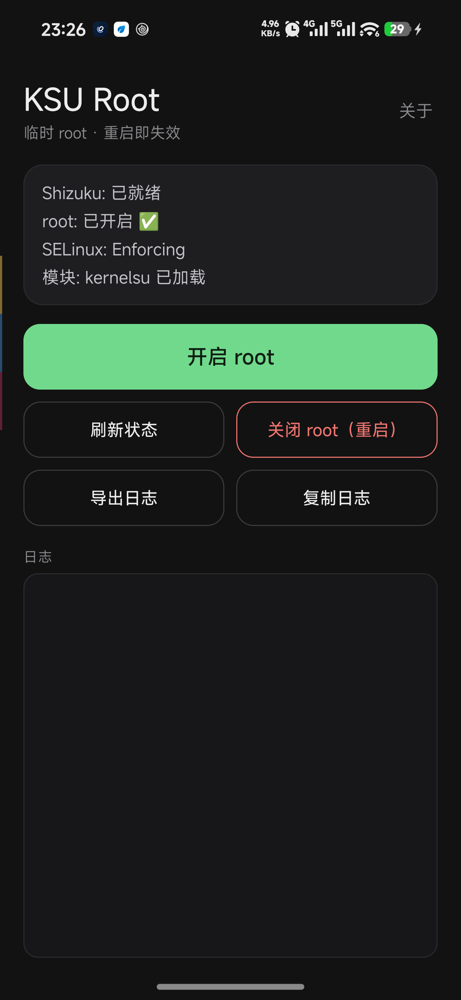
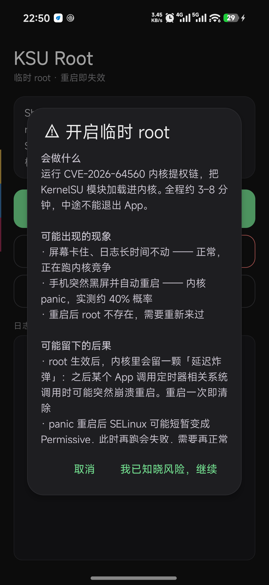
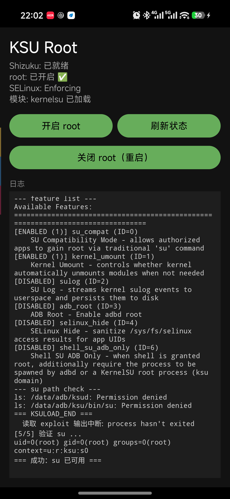
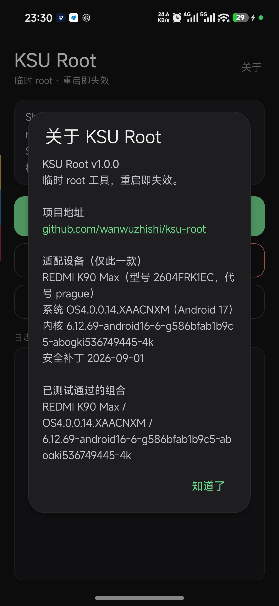
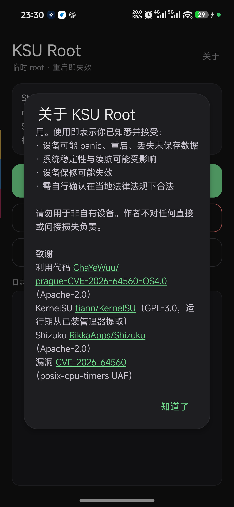

# KSU Root

> 在 Redmi K90 Max（代号 `prague`，OS4.0.0.14）上，从手机端一键开一个**临时 root**。
> 不需要电脑，不需要刷机，不需要解锁 Bootloader。重启即失效。

<p align="center">
  
  
  
  
  
</p>

---

## 这是什么

把 [prague-CVE-2026-64560-OS4.0](https://github.com/ChaYeWuu/prague-CVE-2026-64560-OS4.0) 那套**电脑 + adb** 的提权流程，封装成一个 Android App：

| 电脑上原本要做的 | 现在在手机上点一下 |
|---|---|
| 插线、`adb push` 五个载荷 | App 自动部署 |
| `adb shell sh kp_arm.sh` 布防 kprobe | 自动布防并校验 |
| `adb shell -tt ./pk64560 --run` | `ptyrun` 分配 pty 后运行 |
| 手动往 root shell 里敲 ksud 命令 | 捕获 `ROOT_CHILD_HOLD_PASS` 后自动注入 |
| `su -c id` 验证 | 自动验证并显示结果 |

**它能给你**：`su -c id` 返回 `uid=0(root) ... context=u:r:ksu:s0`，KernelSU 管理器显示「工作中」。

## 这**不是**什么

- ❌ **不是持久化 root**。重启就没了，也不写 boot 分区。
- ❌ **不支持其他机型**。代码里有严格的机型/指纹校验，指纹不匹配直接失败退出。这不是保守，是 hazard：内核地址、结构体偏移、slab 参数全部是这一版内核上量出来的，换个版本会直接把内核写坏。
- ❌ **不是 Magisk**。没有模块系统、没有隐藏、不开机自启。
- ❌ **不保证一次成功**。实测约 40% 的概率会内核 panic 并重启，重启后重来。

---

## 支持设备

**只有这一台**：

```
机型        REDMI K90 Max (2604FRK1EC)
代号        prague
系统        澎湃 OS 4.0.0.14.XAACNXM
指纹        Redmi/prague/prague:17/CP2A.260605.016/OS4.0.0.14.XAACNXM:user/release-keys
内核        6.12.69-android16-6-g586bfab1b9c5-abogki536749445-4k
安全补丁     2026-09-01
```

其他版本**大概率不工作**，而且失败方式可能是内核 panic 而不是优雅报错。

---

## 前置条件

1. **Shizuku 已安装并运行**
   - 从 [RikkaApps/Shizuku](https://github.com/RikkaApps/Shizuku/releases) 下载官方版（**不要用各种"优化版""内置 adb 版"，实测有假包**）
   - 用 adb 或无线调试启动服务
   - 授权本 App
   - **Shevery 也支持**：[HmnDev-Tech/shevery](https://github.com/HmnDev-Tech/shevery) 是 Shizuku 的 fork，保留了同名 binder service 与 `moe.shizuku.manager.permission.API_V23` 权限，只换了包名（`com.hamondev.shevery`）。本 App 已适配它的包名。注意**两者只能装一个**，装 Shevery 前必须先卸载官方 Shizuku

2. **KernelSU 管理器已安装**
   - 从 [tiann/KernelSU](https://github.com/tiann/KernelSU/releases) 下载
   - **不需要**它现在是"工作"状态，只需要装在那儿——App 会从它的 APK 里抽取 `ksud`

3. **设备上留着这几个文件**（如果之前手动跑过）
   - `/data/local/tmp/kernelsu-prague.ko.disabled` —— 必须改名，否则 exploit 会加载那个 uapi=2 的旧模块，管理器会报"需要更新内核"

---

## 使用

### 第一次

1. 启动 Shizuku（见下节），确认 App 状态行显示 `Shizuku: 已就绪`
2. 点 **开启 root**
3. 读一遍风险提示，点 **我已知晓风险，继续**
4. 等 3–8 分钟。**期间不要退出 App**

成功的标志：状态行变 `root: 已开启 ✅`、`模块: kernelsu 已加载`，日志出现 `=== 成功: su 已可用 ===`。

### 之后想验证

```bash
adb shell su -c id
# uid=0(root) gid=0(root) groups=0(root) context=u:r:ksu:s0
```

### 关闭 root

点 **关闭 root（重启）**。这是唯一可靠的方式——`stage0` 改过内核的 `random_table`，没法热恢复。

---

## 每次重启后必须做：启动 Shizuku

Shizuku 是用户态进程，不在 init 服务表里，**重启就没了**。两种启动方式：

### 方式一：手机上（推荐，不用电脑）

1. 设置 → 开发者选项 → **无线调试** → 打开
2. 回到 Shizuku App，点 **启动**（首次需要点"配对"输入六位码，配对一次即可）
3. 授权本 App

> **MIUI 坑**：如果配对码通知不显示，去「设置 → 通知管理 → 通知显示设置」把通知样式改成「原生样式」。

### 方式二：电脑 adb

```bash
BASE=$(adb shell pm path moe.shizuku.privileged.api | sed 's/^package://; s|/base.apk$||')
adb shell "setsid $BASE/lib/arm64/libshizuku.so --apk=$BASE/base.apk > /dev/null 2>&1 < /dev/null &"
```

> 官方启动器是伪装成 `.so` 的 native 可执行文件，**必须带 `--apk=` 参数**。直接 `app_process` 调会立刻退出。

**开机自启不可靠**：Shizuku 的 `BootCompleteReceiver` 有 ADB 分支，但实测 3 次重启只有 1 次成功拉起，`adbStart()` 大多数时候没执行。别指望它。

---

## panic 重启了怎么办

这是**预期行为**，不是 bug。利用链本身有约 40% 概率在 `stage0`（slab 竞争）阶段触发内核 panic。

1. 手机会黑屏并自动重启，等 40–60 秒
2. 重开 App，主按钮会变成 **继续上次（已中断）**
3. 用上面任一方式启动 Shizuku
4. 点 **继续上次**

App 会把当前步骤写进 SharedPreferences，重启后通过 `elapsedRealtime` 变小判断出"被整机重启打断"，所以不需要你回忆跑到哪了。

**如果连续两次 panic**：正常重启一次让 SELinux 恢复 Enforcing 再试。panic 之后那一轮 boot，MTK AEE 可能让 SELinux 停留在 Permissive，此时再跑会在 `STAGE8_ENV_GATE` 因 `enforcing=0` 失败。

---

## 工作原理（简述）

```
[1] stage0      用 rb_erase 的 Case 1 做一次受控写，改写 random_table[4].data
                → 读 /proc/sys/kernel/random/boot_id 泄漏 KASLR
[2] spray       k_itimer 256B order-1，逐 CPU 串行顶满 qhimark
[3] UAF         第二次触发 CVE-2026-64560，用伪造 miscdevice 接管 misc_list
[4] 物理读写    pipe_buffer 占据目标 slab，建立任意物理地址读写
[5] cred        fork 子进程覆写 cred + SELinux state，拿到 uid=0 且 permissive
[6] KernelSU    在 permissive 窗口里执行 ksud late-load，加载官方 LKM
[7] su          模块就绪后 su_compat 生效，/system/bin/su 变成 ksud 的入口
```

**关键细节**：`[6]` 必须用 `ptyrun` 分配伪终端。exploit 拿到 root 后会 `execl("/system/bin/sh", "sh", "-i")`，而 `sh -i` 没有 tty 会**立刻退出**，注入的命令就被外层 uid=2000 的 shell 接走——表现是"明明注入了却没反应"。

---

## 实测记录

在真机（REDMI K90 Max / OS4.0.0.14）上两次完整跑通：

| 时间 | 场景 | 结果 |
|---|---|---|
| 2026-10-25 22:02 | 冷启动，一次过，约 5 分钟 | `su -c id` → `uid=0` / `u:r:ksu:s0` |
| 2026-10-25 23:08 | `[4/5]` 时 panic 重启 → 断点续跑 → 重来 | 同上；`uptime`=162 证明重启过 |

> **版本说明（重要）**
>
> 这两次实测是在 `1.0.0` 早期构建上完成的，那一版用 `busybox script` 分配 pty、`ksud` 随 APK 分发。
>
> 当前开源版做了两处改动：
> 1. 自写 `ptyrun`（`app/src/main/cpp/ptyrun.c`）替代 `busybox script` —— 去掉 1.4 MB 的 GPL-2.0 二进制
> 2. `ksud` 改为运行时从已装的 KernelSU 管理器 APK 抽取 —— 避免分发 GPL-3.0 二进制，且保证 uapi 版本匹配
>
> 两处改动的关键路径已单独验证：
> - `ptyrun` 在真机上执行 `tty` 返回 `/dev/pts/0`，能正常向 `sh -i` 注入命令
> - ksud 提取返回 `5172384` 字节，`/data/app/.../lib/arm64/libksud.so` 对 shell 可读
>
> **但完整流程尚未在真机上复测。** 如果你跑通了或跑挂了，欢迎开 issue。

## 已知限制

- **重启即失效**，无持久化
- **每次重启要手动启动 Shizuku**
- **开过 root 之后内核里有颗延迟炸弹**：`posix_cpu_timer_del` 相关的 dangling timer 节点会留在内核里，之后任意进程调 `timer_delete` 可能 panic 重启（pstore 里能看到 `posix_cpu_timer_del+0x140` 的 Oops）。重启一次清除
- **不能用 `boot_id` 判断是否重启**：`stage0` 会改写它，跑完会变成 `d8f06902-80ff-ffff-80e2-d6dcd6ffffff` 这类假值。要用 `/proc/uptime`
- **只支持一个系统版本**，换版本别试

---

## 构建

```bash
# 需要 JDK 17、Android SDK（compileSdk 36）
./gradlew assembleDebug
# 产物 app/build/outputs/apk/debug/app-debug.apk
```

> `gradle/wrapper/gradle-wrapper.properties` 里的 `distributionUrl` 指向腾讯云镜像（国内下载 Gradle 发行版快得多）。如果你在海外，可以换回官方：
> ```
> distributionUrl=https\://services.gradle.org/distributions/gradle-9.1.0-bin.zip
> ```

**重新编译 `ptyrun`**（改了 `app/src/main/cpp/ptyrun.c` 之后必须做）：

```bash
NDK=$ANDROID_HOME/ndk/28.2.13676358
$NDK/toolchains/llvm/prebuilt/*/bin/aarch64-linux-android26-clang \
    -O2 -static -s \
    -o app/src/main/assets/ptyrun \
    app/src/main/cpp/ptyrun.c
```

- AGP 8.13.2 / Gradle 9.1.0 / Kotlin 2.0.21，compileSdk 36 / minSdk 26 / targetSdk 34
- Shizuku 依赖锁在 `dev.rikka.shizuku:api:12.2.0` —— 13.x 的 `Shizuku.newProcess()` 是 private，外部无法调用

**安装**：MIUI 会拦 `adb install`（`INSTALL_FAILED_USER_RESTRICTED`）。有 root 时用 `su -c "pm install -r app-debug.apk"`，否则在开发者选项里打开「USB 安装」。

---

## 给 AI 用

本仓库附带一份面向 AI Agent 的操作指南：[**AI-GUIDE.md**](AI-GUIDE.md)。

它把流程拆成可执行命令、列出每个检查点的判据、以及**明确的禁止操作边界**。如果你的 AI 工具支持读取仓库内文档（Claude Code、Cursor、Codex 等），直接把这个仓库喂给它，让它读 `AI-GUIDE.md` 即可。

---

## 许可与致谢

本项目 **Apache-2.0**。详见 [LICENSE](LICENSE) 与 [NOTICE](NOTICE)。

- 漏洞利用代码来自 [ChaYeWuu/prague-CVE-2026-64560-OS4.0](https://github.com/ChaYeWuu/prague-CVE-2026-64560-OS4.0)（Apache-2.0）——**感谢原作者把整条利用链、偏移和失败模式都写清楚了，没有那份技术文档这个 App 不可能存在**
- KernelSU 用户态与内核模块来自 [tiann/KernelSU](https://github.com/tiann/KernelSU)（GPL-3.0），**运行期从用户已装的 APK 中提取，不随本仓库分发**
- Shizuku 来自 [RikkaApps/Shizuku](https://github.com/RikkaApps/Shizuku)（Apache-2.0）

---

## 免责声明

**仅供安全研究与自有设备调试使用。**

使用本软件意味着你接受：

- 设备可能内核 panic、意外重启、丢失未保存数据
- 系统稳定性可能下降
- 保修可能失效
- 你自己承担当地法律法规的风险

**不要**在非自有设备上使用。作者不对任何直接或间接损失负责。
