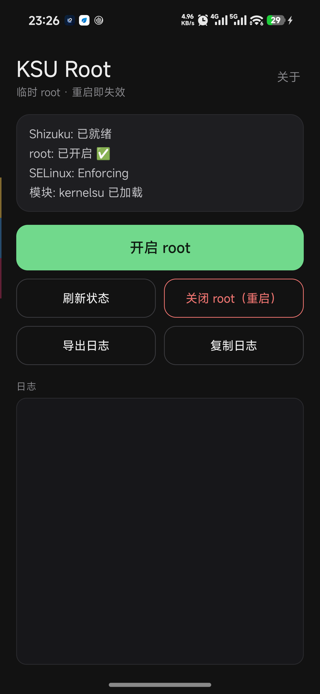
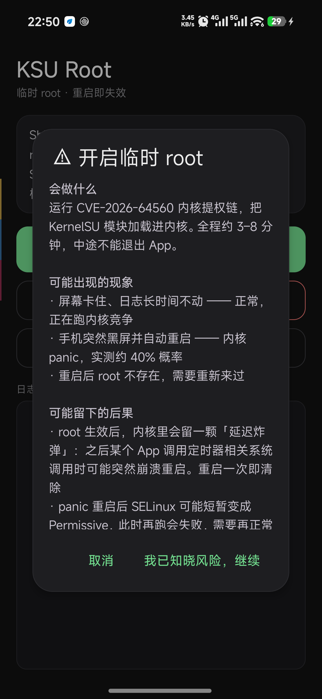
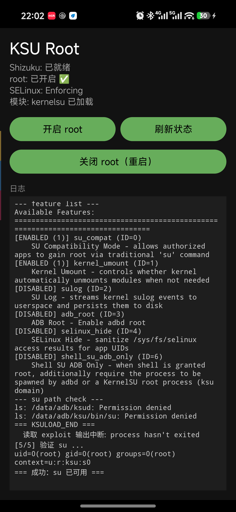
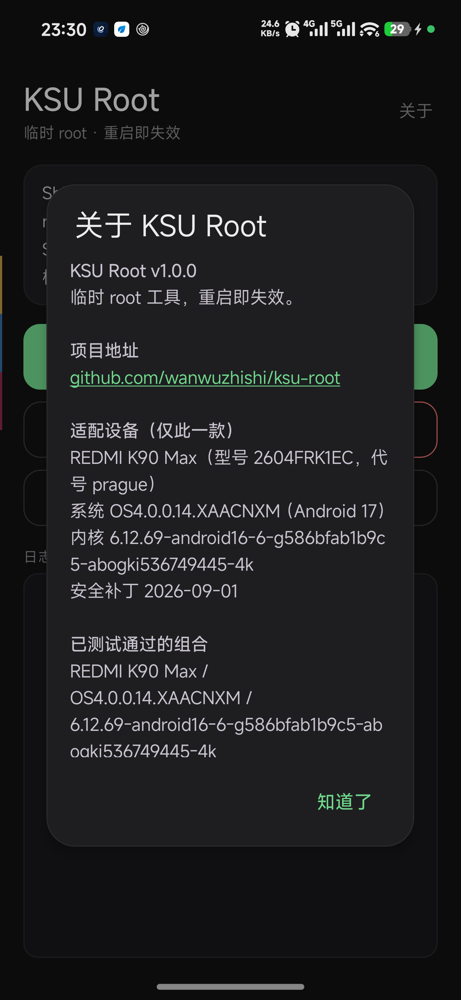
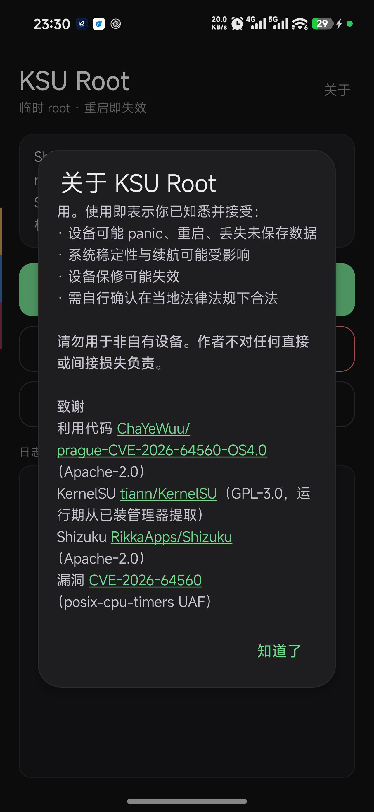

# KSU Root

> 在 Redmi K90 Max（代号 `prague`，OS4.0.0.14 / OS4.0.5.0）上，从手机端一键开一个**临时 root**。
> 不需要电脑，不需要刷机，不需要解锁 Bootloader。重启即失效。

**下载**：[最新 APK](https://github.com/wanwuzhishi/ksu-root/releases/latest) · 当前版本 v1.2.9

**项目介绍**：[KSU Root：给 Redmi K90 Max 开一个重启就消失的临时 root](https://blog.126330.xyz/posts/3c91e7a2/)——作者博客，把下面这些讲一遍，适合先看这个再看细节。

<p align="center">
  
  
  
  
  
</p>

---

## 这是什么

把 [prague-CVE-2026-98260-OS4.0](https://github.com/ChaYeWuu/prague-CVE-2026-98260-OS4.0) 那套**电脑 + adb** 的提权流程，封装成一个 Android App：

| 电脑上原本要做的 | 现在在手机上点一下 |
|---|---|
| 插线、`adb push` 载荷 | App 自动部署 |
| `adb shell -tt ./pk64560 --run` | `ptyrun` 分配 pty 后运行 |
| 手动往 root shell 里敲 ksud 命令 | 捕获 `interactive root child` 后自动注入 |
| `su -c id` 验证 | 自动验证并显示结果 |

**它能给你**：`su -c id` 返回 `uid=0(root) ... context=u:r:ksu:s0`，KernelSU / SukiSU 管理器显示「工作中」。

### 与上一代的区别

v1.0.x ~ v1.1.x 用的是 CVE-2026-64560，那条链的竞争窗口只有 14 条指令（约 10 ns），必须靠 kprobe 在 `posix_cpu_timer_del+72` 人为制造延迟才抓得到，而且对时序极其敏感 —— 实测无扰动时 21 次全 miss。

v1.2.0 起换成 **CVE-2026-98260**，窗口由父进程是否 `wait4()` 决定，理论上是无限的。**不再需要 kprobe、不再需要 tracefs、不再需要布防**。2026-11-18 在真机上一次跑通，零 panic、零重启。

## 这**不是**什么

- ❌ **不是持久化 root**。重启就没了，也不写 boot 分区。
- ❌ **不支持其他机型**。代码里有严格的机型/指纹校验，指纹不匹配直接失败退出。这不是保守，是 hazard：内核地址、结构体偏移、slab 参数全部是这一版内核上量出来的，换个版本会直接把内核写坏。
- ❌ **不是 Magisk**。没有模块系统、没有隐藏、不开机自启。
- ❌ **不保证一次成功**。仍有失败可能；失败后必须先重启（见下）。

---

## 漏洞：CVE-2026-98260

`exec` 在 `de_thread()` 之后、`exec_mmap()` 之前没有清理 POSIX CPU timer。

1. 非 leader 线程执行 `execve()` 时，`begin_new_exec()` 先调 `de_thread(me)`，把 leader 的 `struct pid` 从 `PIDTYPE_PID` 哈希桶里摘掉（`transfer_pid(leader, tsk, PIDTYPE_TGID)` + `release_task(leader)`）。
2. 接着调 `exec_mmap(bprm->mm)`。如果这一步失败返回，`begin_new_exec()` 走 `goto out`，**跳过**后面的 `posix_cpu_timers_exit(me)`。
3. 在此之前，`posix_cpu_timer_del()` 会调 `cpu_timer_task_rcu(timer)`（即 `pid_task(it.cpu.pid, PIDTYPE_PID)`）。桶已经空了，返回 NULL，函数直接 `goto out` —— **不 disarm**，`k_itimer` 对象照常被释放。
4. 内核的定时器红黑树里就留下一个指向已释放对象的节点。等 `cleanup_timerqueue()` 对这颗节点做 `timerqueue_del` → `rb_erase_cached` 时，`rb_next()` 读到的 `node->rb_right` 正好落在 SLUB 对象的 freepointer 位置（`s->offset = object_size/2`），于是拿一个垃圾指针去解引用 —— 内核 panic。

**触发要点**：

- clock 必须是 `CLOCK_THREAD_CPUTIME_ID`（走 `PIDTYPE_PID`；进程级的 `CLOCK_PROCESS_CPUTIME_ID` 走 `PIDTYPE_TGID`，桶是完好的，没有 UAF）
- 定时器必须真的入树：`SIGEV_SIGNAL`、`it_value` 设成很大的值、信号被 `sigmask` 挡住
- leader 必须活着（`group_dead` 一旦为真，整棵树会被清干净，反而没洞）
- 必须让 `exec_mmap()` 失败

**上游修复**：把 `posix_cpu_timers_exit()` 提前到 `de_thread()` 紧后面执行，不等 `exec_mmap()`。

---

## 支持设备

**只有这一台，两个系统版本**：

```
机型        REDMI K90 Max (2604FRK1EC)
代号        prague
内核        6.12.69-android16-6-g586bfab1b9c5-abogki536749445-4k
系统        澎湃 OS 4.0.0.14.XAACNXM     ← 真机实测通过（2026-10-25）
            OS4.0.5.0.XAACNXM           ← 真机实测通过（2026-11-05）
指纹        Redmi/prague/prague:17/CP2A.260605.016/OS4.0.0.14.XAACNXM:user/release-keys
            Redmi/prague/prague:17/CP2A.260605.016/OS4.0.5.0.XAACNXM:user/release-keys
            Redmi/prague/prague:17/CP2A.260605.016/17OS4.0.261020.233332783.MTPECN.S:user/release-keys
安全补丁     2026-09-01 / 2026-10-01
```

**为什么 4.0.5.0 也能用**：那个 OTA 没有重编内核。把 OTA 的 `boot` 分区解出来得到的内核与 4.0.0.14 是同一个二进制：版本串、git hash、ABO build id、编译时间全部相同，CVE-2026-64560 的上游修复（`920f893f`）也不在其中。逐地址反汇编核验过关键偏移全部吻合。

> **注意**：OTA 的 `META-INF/com/android/metadata` 里 `post-build` 写的是预发布串 `17OS4.0.261020.233332783.MTPECN.S`，真机安装后 `getprop ro.build.fingerprint` 报的却是 `OS4.0.5.0.XAACNXM`。v1.0.4 只认前者，会在正式版上被 gate 拒绝；v1.0.5 起同时认两个串。

判断标准看 **`uname -r` 和 ABO build id**，不是看系统版本号。内核一变，全部硬编码偏移作废，失败方式可能是内核 panic 而不是优雅报错。

---

## 前置条件

1. **Shizuku 已安装并运行**
   - 从 [RikkaApps/Shizuku](https://github.com/RikkaApps/Shizuku/releases) 下载官方版（**不要用各种"优化版""内置 adb 版"，实测有假包**）
   - 用 adb 或无线调试启动服务
   - 授权本 App
   - 也支持第三方实现，详见下面的「兼容的 Shizuku 实现」

2. **内核管理器已安装：SukiSU Ultra 或 KernelSU，二选一**
   - [SukiSU Ultra](https://github.com/SukiSU-Ultra/SukiSU-Ultra/releases)（优先）或 [tiann/KernelSU](https://github.com/tiann/KernelSU/releases)
   - **不需要**它现在是"工作"状态，只需要装在那儿——App 会从它的 APK 里抽取 `ksud`
   - 两个都装也行，App 按 SukiSU → KernelSU 的顺序取第一个能用的；想指定用哪个，点主界面的「管理器」那行切
   - ⚠️ **`ksud` 和内核模块必须来自同一个管理器**：`late-load` 加载的就是 ksud 自带的那份 ko。混用会 uapi 不匹配，管理器一直报"需要更新内核"
   - 换了管理器分支之后**必须先重启**再点按钮，否则旧模块还在内核里，新 ko 会因模块名 `kernelsu` 重名而加载失败（`File exists`）
   - SukiSU 不同版本里 ksud 的伪装文件名会变（实测 `libfdbqiupsrx.so` → `libtqqfthevwb.so`，大小也从 6,102,016 变到 6,093,280）。App 会在 `lib/arm64/` 下按大小自动找，不需要手动指定

3. **设备上留着这几个文件**（如果之前手动跑过）
   - `/data/local/tmp/kernelsu-prague.ko.disabled` —— 必须改名，否则会被误当成要加载的模块

---

## 使用

### 第一次

1. 启动 Shizuku（见下节），确认 App 状态行显示 `Shizuku: 已就绪`
2. （可选）点 **管理器** 那行，确认要用哪个管理器。默认「自动」= SukiSU → KernelSU 取第一个能用的；两个都装时建议手动选一次
3. 点 **开启 root**
4. 读一遍风险提示，点 **我已知晓风险，继续**
5. 等 1–10 分钟。**期间不要退出 App**。`[5/5]` 会弹一个「等待 root 生效」的进度框，那是在等 `ksud late-load` 把 `su` 装好

成功的标志：状态行变 `root: 已开启 ✅`、`模块: kernelsu 已加载`，并弹出「root 已就绪」。

### 之后想验证

```bash
adb shell su -c id
# uid=0(root) gid=0(root) groups=0(root) context=u:r:ksu:s0
```

### 关闭 root

点 **关闭 root（重启）**。这是唯一可靠的方式——内核内存已经被改过，没法热恢复。

---

## 每次重启后必须做：启动 Shizuku

Shizuku 是用户态进程，不在 init 服务表里，**重启就没了**。两种启动方式：

### 方式一：手机上（推荐，不用电脑）

1. 设置 → 开发者选项 → **无线调试** → 打开
2. 回到 Shizuku App，点 **启动**（首次需要点"配对"输入六位码，配对一次即可）
3. 授权本 App

> **MIUI 坑**：如果配对码通知不显示，去「设置 → 通知管理 → 通知显示设置」把通知样式改成「原生样式」。

### 方式二：电脑 adb

```bash
BASE=$(adb shell pm path moe.shizuku.privileged.api | sed 's/^package://; s|/base.apk$||')
adb shell "setsid $BASE/lib/arm64/libshizuku.so --apk=$BASE/base.apk > /dev/null 2>&1 < /dev/null &"
```

> 官方启动器是伪装成 `.so` 的 native 可执行文件，**必须带 `--apk=` 参数**。直接 `app_process` 调会立刻退出。

**开机自启不可靠**：Shizuku 的 `BootCompleteReceiver` 有 ADB 分支，但实测 3 次重启只有 1 次成功拉起，`adbStart()` 大多数时候没执行。别指望它。

---

## 兼容的 Shizuku 实现

本 App 通过官方 `dev.rikka.shizuku:api` 连接 Shizuku 服务，所以能不能用取决于两件事，**缺一不可**：

1. 保留名为 `"shizuku"` 的 binder service，以及 `IShizukuService` 的 AIDL 全名；
2. 保留 `moe.shizuku.manager.permission.API_V23` 这个权限名 —— 官方 API 库把它**硬编码**在 `checkSelfPermission()` 里，fork 改成自己前缀后就请求不到授权。

| 实现 | 包名 | 权限名 | 状态 |
|---|---|---|---|
| [RikkaApps/Shizuku](https://github.com/RikkaApps/Shizuku)（官方） | `moe.shizuku.privileged.api` | `moe.shizuku.manager.permission.API_V23` | ✅ 已实测 |
| [HmnDev-Tech/shevery](https://github.com/HmnDev-Tech/shevery) | `com.hamondev.shevery` | 保留 `moe.*` | ✅ 已实测 |
| [yangFenTuoZi/Shizuku](https://github.com/yangFenTuoZi/Shizuku) | `moe.shizuku.privileged.api` | 同官方 | ⚪ 同包名同权限，理论可用 |
| [rushiranpise/Shizuku-Next](https://github.com/rushiranpise/Shizuku-Next) | `moe.shizuku.privileged.api` | `moe.shizuku.manager.permission.API_V23` | ⚪ 同上 |
| [thejaustin/ShizukuPlus](https://github.com/thejaustin/ShizukuPlus) 的 `dropin` 版 | `moe.shizuku.privileged.api` | `af.shizuku.plus.permission.API_V23` | ⚪ 同上 |
| thejaustin/ShizukuPlus 的 `shizukuplus` 独立版 | `af.shizuku.plus.api` | `af.shizuku.plus.permission.API_V23` | ❌ 权限名不同 |
| [kerneldroid/Nightzuku](https://github.com/kerneldroid/Nightzuku) | `kerneldroid.nightzuku` | `kerneldroid.nightzuku.permission.API` | ❌ 权限名不同 |

「已实测」= 我在真机上跑过整套流程。「理论可用」= 包名和权限名都与官方一致，服务协议没改，但没装机试过。打 ❌ 的两个是权限名换成了自己的前缀，App 能识别出「装了」但授权会失败，状态行会显示 `Shizuku: 版本不兼容`。

**注意**：这些 fork 之间**签名冲突，只能装一个**。装新的之前先卸旧的。

---

## 失败之后必须先重启，不能直接重试

**这条最容易被忽略，代价也最大。**

exploit 中途失败时（`PIPE_PREP_FAIL`、`ATTEMPT_MISS` 之类），虽然它自己会打印 `KERNEL_STATE_RESTORE_PASS dirty=0`，看起来把内核改回去收干净了，但实际并不彻底：

`restore_misc_list` 只把 `misc_list` 的头指针指回去，中间那个伪造的 `miscdevice` 节点**没有从链表里摘下来**，而它指向的内存已经被释放。这时如果直接再点一次「开启」，下一次 `misc_open` 遍历链表就会踩到这块已释放内存直接 panic。

之所以说它「阴」，是因为**它不会当场崩**：上一轮失败后系统看起来一切正常，`getenforce` 还是 Enforcing、`boot_id` 还是原来那个，你可以正常用手机。等你过十分钟再点一次，才会崩。

v1.0.3 起 App 会在跑之前检查这个状态，检测到「上次失败且没重启过」就直接拒绝并提示重启。

### 另外一个已知的残留

`ATTEMPT_DEFER` 会把停在 `pause()` 的 victim 故意留着不 reap（这是设计的一部分，为了不打断后续轮次的时序）。这些 victim 每个挂着若干悬空 timer 节点。多轮 DEFER 之后残留会累积，长时间锁屏进深度休眠、系统集中回收 slab 时可能踩到，表现是「root 成功后锁屏十几分钟突然重启」。

v1.1.15 起加了 `retire_victims_safe()`：defer 之前先 kill victim、把 timer freelist 排空再决定要不要 waitpid。没排空就放弃这一轮、不 reap。

---

## 工作原理（简述）

```
[1] 触发层      B 线程建 32 个 CLOCK_THREAD_CPUTIME_ID timer 后 execv，
                S 线程循环 mprotect 抢 mmap 写锁，制造 exec_mmap() 失败
[2] stage0      用 rb_erase 的 Case 1 做一次受控写，改写 random_table[4].data
                → 读 /proc/sys/kernel/random/boot_id 泄漏 KASLR
[3] spray       k_itimer 264B order-1（31 槽位），逐 CPU 串行
[4] bridge      伪造 miscdevice 接管 misc_list，拿到任意内核读写
[5] 物理读写    pipe_buffer 占据目标 slab，建立任意物理地址读写
[6] cred        fork 子进程覆写 cred + SELinux state，拿到 uid=0 且 permissive
[7] KernelSU    在 permissive 窗口里执行 ksud late-load，加载并安装 LKM
[8] su          模块就绪后 su_compat 生效，/system/bin/su 指向 ksud
```

**两个关键细节**：

- `[7]` 必须用 `ptyrun` 分配伪终端。exploit 拿到 root 后会 `execve("/system/bin/sh", "-i")`，而 `sh -i` 没有 tty 会**立刻退出**，注入的命令就被外层 uid=2000 的 shell 接走——表现是"明明注入了却没反应"。
- **`ksud late-load` 不能拆开**。exploit 的 payload 只做 `finit_module`，不创建 `/data/adb/ksu/bin/su` 和 `/system/bin/su`——这两个是 `late-load` 的用户空间安装部分做的。只加载模块不安装，结果就是「模块在、su 永远不出现」。v1.2.6 起让 payload 跳过模块加载，整个「加载 + 安装」都交给 `ksu_load_setup.sh` 的 `late-load` 一次做完。

---

## 实测记录

### CVE-2026-98260（v1.2.x）

| 时间 | 版本 | 结果 |
|---|---|---|
| 2026-11-18 22:11 | v1.2.6 (versionCode 38) | **一次跑通，零 panic、零重启**。`su -c id` → `uid=0` / `u:r:ksu:s0`，`kernelsu 536576 - Live`，`/system/bin/su` 6,093,280 B |

### CVE-2026-64560（v1.0.x ~ v1.1.x）

| 时间 | 版本 | 结果 |
|---|---|---|
| 2026-10-25 22:02 | v1.0.0 | 冷启动一次过，约 5 分钟 |
| 2026-10-25 23:08 | v1.0.0 | `[4/5]` 时 panic 重启 → 断点续跑 → 成功 |
| 2026-11-05 | v1.0.4 | 第一次 stage0 panic 重启，第二次成功（OS4.0.5.0） |
| 2026-11-06 | v1.1.0 | SukiSU 分支首次全链通过 |
| 2026-11-07 | v1.1.11 | 发布版本，`feature check mount_hide` → supported 证明加载的是 SukiSU 模块 |

---

## 已知限制

- **重启即失效**，无持久化
- **每次重启要手动启动 Shizuku**
- **会关掉 KernelSU 的 `shell_su_adb_only`**：这条 feature 只放行 adbd / ksu 域派生的进程用 `su`，而本 App 走的是 Shizuku（`ppid=1`），不关就必然失败。关掉之后，任何以 shell 身份运行的进程都能用 `su`，安全性弱于默认值——这是本工具能工作的前提，用之前请知情
- **失败后必须先重启**（见上节）
- **可能残留悬空 timer 节点**：多轮 `ATTEMPT_DEFER` 之后 victim 携带的节点会累积，锁屏深度休眠时可能崩溃。v1.1.15 的 `retire_victims_safe()` 会尽量排空
- **不能用 `boot_id` 判断是否重启**：`stage0` 会改写它，跑完会变成假值。要用 `/proc/uptime`
- **只支持这一版内核**（4.0.0.14 与 4.0.5.0 共用同一个内核二进制），换了内核别试
- **`/proc/loadavg` 在本机不可信**：长期显示 19–21，但 `top` 是 757% idle、`procs_running=1`、`/proc/pressure/cpu` 全 0。这是被不可中断睡眠（D 状态）污染的读数，**不要用它判断能不能开跑**

---

## 构建

```bash
# 需要 JDK 17、Android SDK（compileSdk 36）
./gradlew assembleDebug
# 产物 app/build/outputs/apk/debug/app-debug.apk
```

> `gradle/wrapper/gradle-wrapper.properties` 里的 `distributionUrl` 指向腾讯云镜像（国内下载 Gradle 发行版快得多）。如果你在海外，可以换回官方：
> ```
> distributionUrl=https\://services.gradle.org/distributions/gradle-9.1.0-bin.zip
> ```

**重新编译 `ptyrun`**（改了 `app/src/main/cpp/ptyrun.c` 之后必须做）：

```bash
NDK=$ANDROID_HOME/ndk/28.2.13676358
$NDK/toolchains/llvm/prebuilt/*/bin/aarch64-linux-android26-clang \
    -O2 -static -s \
    -o app/src/main/assets/ptyrun \
    app/src/main/cpp/ptyrun.c
```

**payload 说明**：`app/src/main/assets/pk64560` 是上游 [prague-CVE-2026-98260-OS4.0](https://github.com/ChaYeWuu/prague-CVE-2026-98260-OS4.0) 的 `payload/libexploit.so` 原样拷贝（2,296,288 B，静态链接 ET_EXEC，无 PT_INTERP）。要改它就得回上游改 C 源码重新编译，本仓库不含那份源码。

- AGP 8.13.2 / Gradle 9.1.0 / Kotlin 2.0.21，compileSdk 36 / minSdk 26 / targetSdk 34
- Shizuku 依赖锁在 `dev.rikka.shizuku:api:12.2.0` —— 13.x 的 `Shizuku.newProcess()` 是 private，外部无法调用

**安装**：MIUI 会拦 `adb install`（`INSTALL_FAILED_USER_RESTRICTED`）。有 root 时用 `su -c "pm install -r app-debug.apk"`，否则在开发者选项里打开「USB 安装」。

---

## 给 AI 用

本仓库附带一份面向 AI Agent 的操作指南：[**AI-GUIDE.md**](AI-GUIDE.md)。

它把流程拆成可执行命令、列出每个检查点的判据、以及**明确的禁止操作边界**。如果你的 AI 工具支持读取仓库内文档（Claude Code、Cursor、Codex 等），直接把这个仓库喂给它，让它读 `AI-GUIDE.md` 即可。

---

## 许可与致谢

本项目 **Apache-2.0**。详见 [LICENSE](LICENSE) 与 [NOTICE](NOTICE)。

- 漏洞利用代码来自 [ChaYeWuu/prague-CVE-2026-98260-OS4.0](https://github.com/ChaYeWuu/prague-CVE-2026-98260-OS4.0)（Apache-2.0）——本版本的核心
- 上一代利用代码 [ChaYeWuu/prague-CVE-2026-64560-OS4.0](https://github.com/ChaYeWuu/prague-CVE-2026-64560-OS4.0)（Apache-2.0）——v1.0.x / v1.1.x 的基础，那份技术文档把整条链、偏移和失败模式都写清楚了
- KernelSU 用户态与内核模块来自 [tiann/KernelSU](https://github.com/tiann/KernelSU)（GPL-3.0），SukiSU 分支来自 [SukiSU-Ultra/SukiSU-Ultra](https://github.com/SukiSU-Ultra/SukiSU-Ultra)（GPL-3.0），**两者都在运行期从用户已装的 APK 中提取，不随本仓库分发**
- Shizuku 来自 [RikkaApps/Shizuku](https://github.com/RikkaApps/Shizuku)（Apache-2.0）
- 漏洞公告：[CVE-2026-98260](https://nvd.nist.gov/vuln/detail/CVE-2026-98260)

---

## 免责声明

**仅供安全研究与自有设备调试使用。**

使用本软件意味着你接受：

- 设备可能内核 panic、意外重启、丢失未保存数据
- 系统稳定性可能下降
- 保修可能失效
- 你自己承担当地法律法规的风险

**不要**在非自有设备上使用。作者不对任何直接或间接损失负责。
